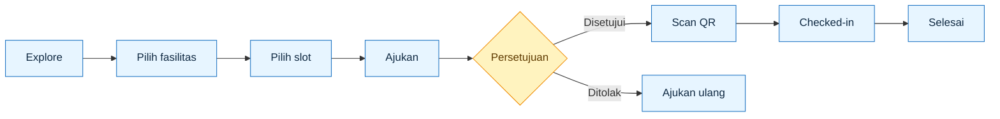

# Gamaspace


<p align="center">
  
</p>

<p align="center">
  
</p>

<p align="center">
  <a href="https://dhama29.github.io/booking_room/"><strong>Open live demo →</strong></a>
</p>

Gamaspace adalah platform peminjaman fasilitas kampus yang menghubungkan pengguna, admin, dan petugas lapangan dalam satu alur booking yang jelas. Pengguna dapat melihat ruang yang sesuai, memilih slot yang tersedia, lalu mengikuti status pengajuan sampai kunci dikembalikan.

Satu ruang kerja untuk booking yang lebih teratur: pengguna menemukan ruang, admin mengatur keputusan, dan petugas memastikan serah-terima berjalan cepat.

## Masalah → Solusi

| Masalah                           | Solusi Gamaspace                                |
| --------------------------------- | ----------------------------------------------- |
| Jadwal tersebar dan rawan bentrok | Slot tersedia real-time dan anti double-booking |
| Persetujuan dilakukan manual      | Dashboard admin dengan status yang jelas        |
| Serah-terima kunci sulit dilacak  | Bukti QR, scanner, dan log check-in             |
| Riwayat peminjaman tidak terpusat | Akun dan data tersinkron melalui Firebase       |

## Fitur Utama

**Pengguna**

- Cari fasilitas dan lihat denah interaktif.
- Pilih tanggal, jam, dan durasi.
- Ajukan dengan validasi data otomatis.
- Terima bukti booking dengan QR.
- Lihat riwayat, batalkan, checkout, atau ajukan ulang.

**Admin & Petugas**

- Kelola fasilitas, jadwal, dan denah.
- Setujui atau tolak pengajuan.
- Pantau status melalui dashboard.
- Scan QR saat serah-terima kunci.
- Ekspor laporan CSV/PDF.

### Tiga layar utama

1. **Halaman pengguna** — eksplorasi fasilitas, jadwal, formulir, dan riwayat.
2. **Panel admin** — dashboard, pengajuan, fasilitas, akun, dan laporan.
3. **Scanner petugas** — validasi QR dan pencatatan kunci secara langsung.

## Teknologi

| Area     | Teknologi                           |
| -------- | ----------------------------------- |
| Frontend | HTML5, CSS3, JavaScript vanilla     |
| Data     | Firebase Realtime Database REST API |
| Auth     | Firebase Authentication (opsional)  |
| Visual   | SVG, Canvas, QR generator           |
| Fallback | JSON seed dan LocalStorage          |

## Alur Singkat

`Explore` → `Pilih fasilitas` → `Pilih slot` → `Ajukan` → `Disetujui` → `Scan QR` → `Checked-in` → `Selesai`

Pengajuan yang disetujui menghasilkan bukti QR. Saat peminjam datang, petugas memindai QR, menyerahkan kunci, dan mengubah status menjadi **Checked-in**. Setelah kunci dikembalikan atau waktu pemakaian berakhir, status berubah menjadi **Selesai**.




## Penggunaan AI

AI digunakan untuk membantu analisis kebutuhan, perancangan alur dan data, implementasi UI, pengecekan edge case, pengujian, serta penyusunan dokumentasi. Semua hasil AI ditinjau dan diuji kembali sebelum digunakan.

## Mulai Cepat

| Akses                                                             | Tujuan                 |
| ----------------------------------------------------------------- | ---------------------- |
| [Live demo](https://dhama29.github.io/booking_room/)              | Coba aplikasi langsung |
| `index.html`                                                      | Halaman pengguna       |
| [`admin.html`](https://dhama29.github.io/booking_room/admin.html) | Panel admin            |
| `ketentuan.html`                                                  | Ketentuan peminjaman   |

```bash
python3 -m http.server 8000
```

Buka `http://localhost:8000/` di browser.

### Login Admin Demo

- **Halaman:** [`/admin.html`](https://dhama29.github.io/booking_room/admin.html)
- **Email:** `admin@gmail.com`
- **Password:** `admin12345`

> Kredensial Khusus Juri dengan Hak Tertinggi.

<details>
<summary><strong>Dokumentasi teknis lengkap</strong></summary>

## Arsitektur Data

```
GitHub Pages (statis)  ──fetch REST──▶  Firebase Realtime Database
                                          ├── facilities    (CRUD admin + denah ruangan, dibaca semua pengguna)
                                          ├── availability  (policy + jadwal mingguan + pengecualian)
                                          ├── bookings      (pengajuan semua pengguna + status + uid)
                                          └── users         (profil dasar akun yang login — opsional)

Fallback (otomatis bila Firebase tidak terjangkau / ditolak Rules):
data/*.json (seed) + LocalStorage (cfb_bookings, cfb_facility_overrides)
```

Akses ke Firebase memakai **REST API Realtime Database** (`GET/PUT/PATCH/POST/DELETE <databaseURL>/<path>.json`) — cukup `databaseURL` pada `assets/js/firebase-config.js`, **tanpa apiKey & tanpa SDK**.

### Pemilihan mode saat dimuat

| Kondisi node `facilities`        | Mode                      | Perilaku                                                                                                                                                                                                |
| -------------------------------- | ------------------------- | ------------------------------------------------------------------------------------------------------------------------------------------------------------------------------------------------------- |
| Terisi                           | **Firebase**              | Semua data dari server (tersinkron lintas perangkat)                                                                                                                                                    |
| **Kosong** (belum di-seed)       | **Firebase** + seed lokal | **Pengajuan tetap tersinkron**; daftar fasilitas memakai `data/facilities.json` sementara. Admin Panel menampilkan banner kuning **"Unggah data awal"** — satu klik menyimpan seed ke server.           |
| Tidak terjangkau / ditolak Rules | Lokal                     | `data/*.json` + LocalStorage per-perangkat; Admin Panel menampilkan banner abu berisi penyebab. Setelah **login**, bila penolakan karena Rules `auth != null`, data dimuat ulang otomatis dengan token. |

## Struktur Proyek

```
campus-facility-booking/
├── index.html                 # Landing page 1 halaman (logo, judul, CTA — clean, tanpa kartu)
├── fasilitas.html             # Halaman pengguna (SPA: Explore → Summary + Peminjaman Saya)
├── admin.html                 # Admin panel terpisah (gate, analitik, CRUD, persetujuan, editor denah)
├── ketentuan.html             # Halaman Ketentuan Peminjaman (dua bahasa)
├── firebase-seed.json         # Data awal untuk import ke Realtime Database (opsional)
├── README.md
├── SETUP-FIREBASE.md          # Panduan cepat 3 langkah
├── data/                      # ===== DATA AWAL (seed / fallback) =====
│   ├── facilities.json        # 10 fasilitas + kategori + jam operasional + denah (layout)
│   └── availability.json      # Policy peminjaman + jadwal terisi mingguan + pengecualian
└── assets/
    ├── css/
    │   ├── base.css           # Design token, tombol, form, toast, modal, auth UI, lang toggle, denah (shared)
    │   ├── app.css            # Halaman pengguna + ketentuan + kartu bukti
    │   ├── landing.css        # Landing page 1 halaman (minimal, efek logo, tanpa kartu)
    │   └── admin.css          # Admin panel (sidebar, KPI, chart, tabel, editor denah)
    ├── js/
    │   ├── i18n.js            # Kamus ID/EN + penerjemah atribut HTML + toggle
    │   ├── core.js            # Util, notifikasi card, modal konfirmasi, validator UGM
    │   ├── firebase-config.js # KONFIGURASI FIREBASE (databaseURL + apiKey/authDomain opsional)
    │   ├── auth.js            # Firebase Auth: Google + email/kata sandi (SDK dimuat dinamis)
    │   ├── data.js            # Data layer: Firebase RTDB (REST, + token auth) + fallback lokal + slot engine
    │   ├── floorplan.js       # Renderer denah ruangan SVG (ikon perangkat + bangku)
    │   ├── proof.js           # Kartu bukti peminjaman (canvas → PNG + QR)
    │   ├── app.js             # Logic SPA sisi pengguna
    │   ├── admin.js           # Logic admin panel + editor denah
    │   └── vendor/
    │       └── qrcode.min.js  # qrcode-generator (MIT, Kazuhiko Arase) — lokal, tanpa CDN
    └── images/
        ├── readme-typing.svg     # animasi teks highlight pada README
        ├── logo.png              # logo Gamaspace (landing, navbar, gate & sidebar admin)
        ├── balairung.jpg         # foto Balairung UGM untuk footer sistem
        ├── ugm-logo-white.png    # logo UGM putih untuk footer sistem
        ├── logo-white.png        # varian logo putih
        ├── ugm-logo.png          # logo UGM berwarna
        ├── ugm-emblem.png        # emblem UGM berwarna
        ├── ugm-emblem-white.png  # emblem UGM putih
        ├── favicon.png           # 512×512
        ├── favicon-32.png / favicon-16.png
        ├── favicon.svg           # favicon berbasis SVG
        ├── favicon.ico           # 16/32/48 (fallback lama)
        └── apple-touch-icon.png  # 180×180 (iOS)
```

## Database (data/\*.json)

### `data/facilities.json`

```json
{
  "id": "FAC-001",
  "name": "Ruang Multimedia",
  "category": "Ruang Kelas",
  "location": "Gedung Utama Lt. 2",
  "capacity": 40,
  "facilities": ["Projector", "AC", "Wi-Fi"],
  "status": "Available",
  "description": "…",
  "openHours": { "start": "08:00", "end": "16:00" },
  "layout": {
    "w": 10,
    "h": 7, // ukuran ruangan (satuan grid ≈ meter)
    "seats": 40, // jumlah bangku (dihitung ulang utk mode rounds/custom)
    "seatMode": "rows", // rows | circle | rounds | utable | custom
    "roundTables": 4, // (mode rounds) jumlah meja bundar
    "roundChairs": 8, // (mode rounds) kursi per meja
    "seatsCustom": [], // (mode custom) bangku manual [{x, y, rot}]
    "items": [
      { "type": "whiteboard", "x": 3.5, "y": 0.5, "rot": 0 },
      { "type": "projector", "x": 5, "y": 3.5, "rot": 0 },
      { "type": "door", "x": 8.5, "y": 6, "rot": 0 }
    ]
  }
}
```

- `category`: `Ruang Kelas` | `Laboratorium` | `Aula` | `Olahraga` | `Studio` — dipakai filter & saran ruang.
- `status`: `Available` / `Limited` (ditinjau ketat) / `Unavailable` (tidak dapat diajukan).
- `layout` (denah): tipe item yang tersedia — `screen` (layar), `projector`, `sound`, `whiteboard`, `podium`, `table`, `table-round` (meja bundar), `door`. Susunan bangku diatur `seatMode`: **`rows`** (baris teater), **`circle`** (lingkaran menghadap pusat), **`rounds`** (meja bundar + kursi melingkar, diatur `roundTables` × `roundChairs`), **`utable`** (bentuk U terbuka ke area depan), atau **`custom`** (bangku manual `seatsCustom` — setiap bangku dapat digeser, ditambah, dan dihapus satu per satu dari editor denah; tombol _Ubah ke susunan manual_ membekukan susunan otomatis menjadi manual). Karena data di server mungkin belum memiliki `layout`, aplikasi memakai **denah default dari `data/facilities.json` sebagai fallback tampilan**; admin dapat mengubahnya lewat editor denah (tersimpan ke server).

### `data/availability.json`

Ketersediaan berbasis **pola mingguan** sehingga tidak kedaluwarsa:

```json
{
  "policy": {
    "bookingDaysAhead": 14, // jadwal hanya 14 hari ke depan
    "minDurationHours": 1, // durasi minimum
    "maxDurationHours": 2 // BATAS MAKSIMAL 2 JAM per peminjaman
  },
  "recurring": [
    {
      "facilityId": "FAC-001",
      "weekday": 1,
      "hours": [12, 13],
      "note": "Jadwal kuliah tetap"
    }
  ],
  "exceptions": [
    {
      "facilityId": "*",
      "date": "2026-12-25",
      "hours": "all",
      "note": "Libur Nasional"
    },
    {
      "facilityId": "FAC-002",
      "date": "2026-11-05",
      "hours": [8, 9, 10, 11],
      "note": "Dies Natalis"
    }
  ]
}
```

- `weekday`: 0 = Minggu … 6 = Sabtu. `hours`: daftar **jam mulai** yang sudah terisi.
- `exceptions` dengan `hours: "all"` menutup fasilitas seharian penuh (tombol tanggal dinonaktifkan).
- Slot per jam dibangkitkan otomatis dari `openHours` tiap fasilitas; jam terisi (seed / pengajuan Pending-Approved) otomatis dinonaktifkan.

### Lapisan penyimpanan

**Mode Firebase** (aktif bila `facilities` terisi di Realtime Database):

```
Firebase RTDB
├── facilities/{FAC-001: {...}}     ← CRUD admin langsung menulis ke sini
├── availability/{policy, recurring, exceptions}
└── bookings/{pushKey: {...}}       ← pengajuan semua pengguna + status + alasan
```

- "Peminjaman Saya" menampilkan pengajuan milik pengguna: **terikat uid akun bila login Firebase** (lintas perangkat), atau penanda `clientId` peramban bila tamu. Admin melihat seluruh pengajuan dari semua pengguna; slot terisi diperhitungkan lintas perangkat.
- Pengajuan yang dibuat saat login menyimpan `uid` + `accountEmail` (terlihat admin pada detail pengajuan sebagai baris **Akun**).

**Mode lokal** (fallback otomatis):

```
data/*.json  (seed, read-only)                    ← sumber data awal
cfb_facility_overrides  (LocalStorage, admin)     ← created / updated / deleted
cfb_bookings            (LocalStorage, pengguna)  ← pengajuan + status + alasan penolakan
```

Tombol **Reset ke data awal** di tab Fasilitas: mode Firebase = menimpa node `facilities` di server dengan isi `data/facilities.json`; mode lokal = menghapus lapisan overrides. Pengajuan lama (format slot 2 jam) otomatis dimigrasi ke format jam-per-jam.

## Setup Firebase (sekali saja)

1. **Atur Rules** — Firebase Console → Realtime Database → tab **Rules** → tempel berikut → **Publish**:
   ```json
   {
     "rules": {
       "facilities": { ".read": true, ".write": true },
       "availability": { ".read": true, ".write": true },
       "bookings": { ".read": true, ".write": true },
       "users": { ".read": true, ".write": true },
       "admins": { ".read": true, ".write": true },
       "petugas": { ".read": true, ".write": true },
       "keys": { ".read": true, ".write": true }
     }
   }
   ```
   > Node `users` menyimpan identitas peminjam (auto-isi formulir, lintas perangkat), `admins` daftar email admin, `petugas` daftar **Petugas Lapangan** (alur QR Scanner), dan `keys` kunci fasilitas yang diserahkan di Scanner. **Bila `petugas` atau `keys` belum masuk Rules**, tombol _Tambah Petugas_ pada tab _Admin_ akan menampilkan _“Penyimpanan ditolak Rules — buka akses node /petugas (lihat README)”_ dan pemilihan kunci di Scanner gagal. Bila Rules untuk node ini belum dipublish, aplikasi **tetap berjalan** — fitur terkait otomatis jatuh ke penyimpanan lokal peramban.
2. **Isi data awal** — lewat Console Firebase: menu ⋮ (kanan atas) → **Import JSON** → pilih file `firebase-seed.json` dari folder proyek.
3. **Konfigurasi** — `assets/js/firebase-config.js` sudah berisi URL database ini:
   `https://booking-room-ugm-default-rtdb.asia-southeast1.firebasedatabase.app` (project _booking-room-ugm_). Ganti bila memakai database lain.
4. Muat ulang situs — data fasilitas & pengajuan kini tersaji dari database.

> Catatan: rules terbuka (`.read/.write: true`) diperlukan karena aplikasi tanpa login — cocok untuk prototipe/tugas. Untuk produksi, gunakan Firebase Authentication dan batasi akses per-node. apiKey pada Firebase memang bukan rahasia dan tidak diperlukan pada mode REST ini.

## Firebase Auth — Login Google / Email (opsional)

Login bersifat **opsional** — tanpa konfigurasi pun seluruh situs tetap berfungsi (tombol _Masuk_ memberi tahu bahwa login belum diaktifkan).

> **Hosting? Baca dulu — penyebab login gagal yang paling sering:**
>
> 1. `apiKey` / `authDomain` **kosong** di `assets/js/firebase-config.js` → SEMUA login (Google & email) mati. Isi keduanya dulu.
> 2. Metode login **belum diaktifkan** di Console (Authentication → Sign-in method) → aktifkan **Google** dan **Email/Password**.
> 3. **Domain hosting belum di-Authorized-domains** (Authentication → Settings → Authorized domains) → tombol Google gagal dengan pesan _auth/unauthorized-domain_. Tambahkan `dhama29.github.io` pada daftar domain yang diizinkan.
> 4. **Menambah domain baru di Console tidak perlu unduh ulang** — cukup muat ulang situs.
>
> Halaman login **admin** (`admin.html`) menyediakan **Masuk dengan Google** dan **email + kata sandi**; email akun harus terdaftar sebagai admin/petugas (sama seperti login email).

1. **Isi konfigurasi** — `assets/js/firebase-config.js`:
   ```js
   apiKey: 'AIzaSy…',                              // Project settings → Your apps
   authDomain: 'booking-room-ugm.firebaseapp.com',
   ```
2. **Aktifkan metode login** — Firebase Console → **Authentication → Get started → Sign-in method** → aktifkan **Google** dan/atau **Email/Password**.
3. **Izinkan domain situs** — Authentication → **Settings → Authorized domains** → tambahkan `dhama29.github.io` (dan `localhost` untuk pengujian).
4. Muat ulang situs → tombol **Masuk** muncul di header. Setelah login:
   - pengguna diarahkan ke halaman **Data Identitas** (bila belum pernah mengisi) — lihat bagian berikut,
   - riwayat **Peminjaman Saya** mengikuti akun (terbuka juga di perangkat lain),
   - profil dasar tersimpan di node `users/{uid}` (nama, email, login terakhir).

> Catatan teknis: aplikasi tetap memakai REST untuk RTDB; SDK Auth hanya dimuat **dinamis dari CDN saat apiKey tersedia**, dan `idToken` otomatis dilampirkan ke setiap permintaan tulis (`?auth=<token>`) sehingga Rules yang membatasi `auth != null` tetap didukung. Bila data awalnya ditolak Rules karena belum login, aplikasi **memuat ulang data otomatis setelah login berhasil**.

## Identitas Peminjam — Auto-isi Formulir (per email akun)

Setelah login, pengguna mengisi identitas **sekali saja** pada halaman _Data Identitas_ (menu avatar → _Data Identitas_, atau otomatis dibuka setelah login):

- **Field**: Nama Lengkap, NIM, Email UGM, No. WhatsApp, Program Studi — tervalidasi dengan aturan yang sama seperti formulir pengajuan (NIM UGM, `@mail.ugm.ac.id`, nomor WA Indonesia).
- **Penyimpanan per email akun**: LocalStorage (`cfb_ident_<email>`) selalu ditulis; bila mode Firebase aktif dan node `users` dibuka Rules, identitas juga disimpan ke `users/{uid}/identitas` sehingga **tersinkron lintas perangkat**.
- **Auto-isi saat pemesanan**: setiap kali formulir pengajuan dibuka (atau setelah login di gerbang transaksi), kelima field terisi otomatis dari identitas — **hanya kolom yang masih kosong, dan tetap bisa diubah** per pengajuan.
- **Gerbang transaksi final**: bila pengguna baru login saat _Kirim Pengajuan_ dan identitasnya belum ada, muncul modal _Lengkapi identitas Anda_ (bisa dilewati dengan _Nanti saja_) — isian formulir tidak hilang.
- **Avatar tanpa foto** — bila foto profil (mis. Google) gagal dimuat, avatar otomatis diganti **inisial nama** sehingga tidak ada ikon gambar rusak.

### Menguji login tanpa server Firebase

Set `mockAuth: true` pada `firebase-config.js` — login memakai akun palsu di peramban (khusus pengujian lokal; **jangan aktifkan di produksi**).

## Fitur Sisi Pengguna (index.html)

Alur: **Explore → Select → Schedule → Request → Summary**

- **Transisi antar halaman halus** — perpindahan SPA memakai **View Transitions API** (cross-fade + geser ±0,2 dtk) dengan fallback animasi CSS; otomatis dimatikan untuk `prefers-reduced-motion`.
- **Multi-bahasa ID/EN** — toggle **ID/EN** di header (juga di halaman ketentuan). Bahasa **bawaan selalu Indonesia (id)**; pilihan pengguna tersimpan di LocalStorage. Seluruh teks statis & dinamis (termasuk pesan validasi, toast, nama hari/bulan) diterjemahkan.
- **Explore** — 10 fasilitas; cari (nama/kategori/lokasi/perangkat); filter kategori, status, kapasitas; urutkan.
- **Detail** — deskripsi, perangkat, **denah ruangan (floor plan) interaktif**, jam operasional, durasi maksimal.
- **Denah ruangan (SVG)** — visual bersih: grid ruangan, ikon **layar, proyektor, sound system, papan tulis, podium, meja, pintu**, deretan bangku menghadap area depan, serta legenda + badge jumlah bangku.
- **Schedule (custom jam + maks 2 jam)** — pilih tanggal (14 hari) → **jam mulai per jam** → **durasi 1 / 2 jam** (opsi 2 jam otomatis nonaktif bila jam berikutnya terisi / melewati jam tutup); jam terisi & jam yang sudah lewat hari ini dinonaktifkan. **Jam yang termasuk rentang durasi terpilih ikut terkunci** (contoh: pilih 10:00 + durasi 2 jam → 11:00 ikut terkunci, bergaya garis putus-putus).
- **Request** dengan validasi ketat:
  - **NIM UGM** — regex `^\d{2}/\d{6}/[A-Z]{2,3}/\d{5}$` (contoh `21/456789/PA/20123`), auto-format sambil mengetik.
  - **Email** — wajib email UGM berakhiran `@mail.ugm.ac.id` (mahasiswa) atau `@ugm.ac.id` (staf/dosen).
  - **No. HP** — template prefix **+62**, auto-format `812-3456-7890`, validasi nomor Indonesia.
  - **Jumlah peserta** — maksimal kapasitas ruang; bila peserta ≤ 40% kapasitas muncul **kartu saran ruang lain yang lebih sesuai** — muncul dengan **jeda ±1,2 detik setelah input selesai**, tampilan flat (baris dengan pemisah tipis, tanpa kotak bersarang), tombol _Lihat ruang_ membuka detail fasilitas **di tab yang sama** (navigasi SPA).
  - **Ketentuan peminjaman** — ringkasan + tautan ke `ketentuan.html` + checkbox persetujuan.
- **Notifikasi card** — toast sukses/gagal (ikon, judul, pesan, progress bar, tombol tutup), getar halus + scroll ke isian salah, dan kartu sukses besar di halaman Summary.
- **Tombol kirim dengan loading** — saat pengajuan dikirim, tombol menampilkan **spinner + "Mengirim pengajuan…"** (terkunci ±1,2 detik agar proses terasa konsisten sekaligus menutup latensi jaringan ke Firebase), lalu otomatis pindah ke halaman Summary.
- **Kartu bukti peminjaman + QR** — tombol **Unduh bukti pengajuan** di halaman Summary dan tombol **Unduh bukti** pada setiap item riwayat membuka pratinjau kartu profesional (nomor referensi besar, badge status, ringkasan data) dengan **QR code verifikasi** — dapat diunduh sebagai **PNG resolusi 2×** (`bukti-GMS-…​.png`) untuk **ditunjukkan kepada petugas lapangan saat pengambilan kunci**. **QR baru aktif setelah pengajuan disetujui** — selama masih _Menunggu Persetujuan_, kotak QR menampilkan placeholder _“QR akan aktif setelah pengajuan disetujui”_ sehingga peminjam tidak salah menunjukkan bukti. Nomor referensi pengajuan baru berformat **GMS-YYYYMMDD-XXXX**.
- **Login Firebase Auth** — tombol **Masuk** (Google / email-kata sandi, daftar akun baru) di header; setelah login pengguna diarahkan mengisi **Data Identitas** (bila belum ada) dan riwayat mengikuti akun. Lihat bagian _Firebase Auth_ & _Identitas Peminjam_.
- **Gerbang login di halaman ruangan** — pengguna tamu bebas menjelajah dan melihat jadwal; saat menekan **Ajukan Peminjaman** pada halaman ruangan, muncul gerbang _Login diperlukan_ (Google/email). Setelah masuk (lalu melengkapi identitas bila belum ada), pengguna langsung dibawa ke halaman jadwal; pengajuan terikat `uid` (riwayat lintas perangkat). Bila login belum dikonfigurasi, tersedia pilihan _Lanjut tanpa akun_ agar mode lokal tetap berfungsi (gerbang di tombol kirim tidak mengganggu lagi pada sesi tersebut).
- **Navbar ramping** — tautan _Admin_ dan _Ketentuan_ dihapus dari navbar (Ketentuan tetap tersedia di footer); halaman admin diakses langsung lewat URL `admin.html` dan diamankan login RBAC.
- **Anti double-booking** — cek ulang ketersediaan rentang jam saat submit.
- **Peminjaman Saya** — riwayat yang dapat **diklik untuk membuka detail singkat** (referensi, tanggal, waktu, lokasi, peserta, organisasi) + **keterangan status dalam kalimat lengkap**: ditinjau petugas (kuning) / disetujui (hijau) / ditolak beserta alasannya (merah) / sudah check-in (biru) / selesai (teal) / dibatalkan beserta alasannya (abu). Status terkini + alasan penolakan (jika ada).

### Siklus hidup pengajuan (lifecycle)

```
Pending ──→ Approved ──(petugas pindai QR)──→ Checked-in ──┬─(tombol Checkout peminjam)─→ Selesai
   │ (48 jam)   │ (slot lewat,                            └─(waktu habis, otomatis senyap)─→ Selesai
   ↓            │  tanpa check-in)
Cancelled ←─────┘   (expired / no-show)
Rejected  → dapat diajukan ulang (Ajukan Ulang)
```

**Alur pengambilan kunci (QR petugas lapangan):** setelah pengajuan **disetujui**, peminjam datang ke loket dan **menunjukkan QR pada kartu bukti**. Petugas lapangan **memindainya lewat kamera** (menu _Scanner_ di Admin Panel) atau mengetik **kode fallback**-nya — sistem memvalidasi otomatis (pengajuan ada, berstatus Approved, berjadwal **hari ini**), petugas memilih kunci yang diserahkan, lalu status menjadi **Checked-in** lengkap dengan catatan petugas & jam.

- **Batalkan sendiri** — pengguna dapat membatalkan pengajuannya yang masih **Pending/Approved** dari halaman _Peminjaman Saya_ (modal konfirmasi); slot langsung kembali tersedia.
- **Ajukan Ulang** — pengajuan **Ditolak** menampilkan tombol _Ajukan Ulang_: alur booking dibuka dengan **formulir terisi otomatis** dari data lama + banner berisi nomor & alasan penolakan. Pengajuan lama tercatat `resubmittedAs` ke pengajuan baru.
- **Kuota peminjaman aktif** — maksimum **2 pengajuan aktif** per akun (`maxActiveBookings` pada `firebase-config.js`); Pending + Approved + Checked-in dihitung aktif.
- **Kedaluwarsa otomatis** — Pending yang tidak ditinjau **48 jam** dibatalkan otomatis (`expired`) saat aplikasi/admin dibuka.
- **No-show otomatis** — Approved yang **tidak check-in** sampai masa slot berakhir dibatalkan otomatis (`no-show`); slot kembali tersedia. Pengajuan yang tanggalnya **belum tiba tidak pernah** dibatalkan oleh sweep (pengaman jam perangkat), dan **slot yang sudah berakhir tidak dapat disetujui** — admin menerima pesan _“Tidak dapat disetujui — masa peminjaman sudah berakhir”_ alih-alih pengajuan langsung batal setelah di-ACC.
- **Kode pengambilan kunci (fallback)** — saat pengajuan **disetujui**, sistem membuat **kode 6 karakter** (tanpa 0/O/1/I) pada kartu bukti, di bawah QR (payload QR `GMS-PROOF|…|KODE`). Kode ini **fallback** bila kamera tidak tersedia: petugas mengetiknya di menu _Scanner_. Kode tidak pernah diketik oleh peminjam.
- **Checkout oleh peminjam** — pemakaian ditandai **Selesai** oleh peminjam sendiri: tombol **Kembalikan Kunci & Selesai** pada kartu berstatus Checked-in di _Peminjaman Saya_ (modal konfirmasi); status kunci otomatis kembali **Tersedia**.
- **Auto-close otomatis (senyap)** — pengajuan **Checked-in** yang waktunya habis ditutup otomatis menjadi **Selesai** oleh sistem (penanda `autoClosed`), tanpa badge/notifikasi; kunci kembali tersedia. Sweep berjalan saat Admin Panel / situs pengguna dibuka (dihitung ulang setiap kali halaman data dimuat).

## Admin Panel (admin.html)

**Login admin memakai EMAIL + KATA SANDI atau tombol Masuk dengan Google** (akun Google harus terdaftar sebagai admin/petugas). **Tanpa registrasi mandiri** — akun admin/petugas HANYA ditambahkan oleh pengelola utama melalui tab _Admin_ pada panel (langsung aktif). Akses diberikan bila email terdaftar pada salah satu sumber berikut (dicek berurutan):

0. `rootAdminEmail` di `assets/js/firebase-config.js` — **pengelola utama**, selalu diizinkan (bawaan `dhamashidqiputra2007@mail.ugm.ac.id`).
1. `adminEmails` di `assets/js/firebase-config.js` — cara tercepat; isi dengan email akun admin Anda.
2. Node `/admins` di Realtime Database (format: `"/admins/<key>": "email@contoh.com"`) — diisi ketika pengelola utama **menambahkan** admin baru pada tab _Admin & Akun_.

Email yang tidak terdaftar menerima layar **Akses ditolak** dengan kontak pengelola utama. Bila `rootAdminEmail` belum diatur dan kedua sumber lain masih kosong, **login pertama** pada `admin.html` otomatis mendaftarkan dirinya ke `/admins` (_first-claim_) — bila Rules belum mengizinkan node `/admins`, akses ditolak. Nonaktifkan dengan `allowFirstAdminClaim: false`. Tombol **Keluar** mengakhiri sesi admin.

### Peran Petugas Lapangan (RBAC 3 peran)

Selain **Admin/Root**, terdapat peran **Petugas Lapangan** — pemegang kunci fasilitas. Sumber daftar petugas (dicek berurutan):

1. `petugasEmails` di `assets/js/firebase-config.js` — cara tercepat.
2. Node `/petugas` di Realtime Database — diisi ketika pengelola utama **menambahkan petugas** pada tab _Admin_ (bagian Petugas Lapangan).

**Email petugas bebas domain** — tidak harus alamat `@ugm.ac.id` (berlaku sementara; dapat diperketat kembali bila dibutuhkan). Modal _Tambah Petugas_ menampilkan petunjuk _“Email bebas — tidak harus alamat UGM”_.

Petugas login di `admin.html` yang sama; **menu menyesuaikan peran**:

| Kemampuan                                 | Petugas Lapangan                                                             | Admin / Root                                             |
| ----------------------------------------- | ---------------------------------------------------------------------------- | -------------------------------------------------------- |
| **Scanner** (pindai QR pengambilan kunci) | ✅ satu-satunya alat kerja utama                                             | ❌ (tidak tampil)                                        |
| **Pengajuan**                             | ✅ **baca-saja** (tanpa tombol aksi — perubahan status otomatis oleh sistem) | ✅ penuh (Setujui/Tolak/Tandai Selesai sebagai override) |
| Dashboard, Admin, Pengguna, Fasilitas     | ❌ disembunyikan                                                             | ✅                                                       |
| Kelola petugas                            | ❌                                                                           | ✅ (pengelola utama)                                     |

Chip peran di kaki sidebar menampilkan **"Petugas Lapangan"** / **"Administrator"** (nama tampilan tetap disembunyikan — hanya email). Di bawah brand sidebar terdapat **jam berjalan** (waktu perangkat, detik berjalan + tanggal) — membantu pemilik memverifikasi jam perangkat terhadap jadwal WIB; disembunyikan otomatis pada layar sempit. Semua **popup konfirmasi admin dibuat singkat** (satu baris konteks: referensi · fasilitas · tanggal · jam) agar keputusan cepat tanpa dinding teks.

### Scanner — pindai QR pengambilan kunci (tab khusus petugas)

- **Kamera** — tombol _Aktifkan Kamera_ membuka kamera (p `getUserMedia`, mengutamakan kamera belakang); frame dipindai **jsQR** secara real-time. Kamera hanya aktif pada konteks aman (**HTTPS** — Firebase Hosting ✓); pada demo `file://` gunakan fallback.
- **Fallback kode manual** — input kode 6 karakter dari kartu bukti (untuk kamera gagal/diblokir).
- **Validasi otomatis** — payload `GMS-PROOF|…` (atau kode/referensi) dicocokkan ke database: pengajuan **Approved** + berjadwal **hari ini**. Kesalahan diberi pesan spesifik (tidak ditemukan / sudah check-in / status lain / bukan hari ini).
- **Serah terima kunci** — saat cocok, modal menampilkan identitas peminjam (nama, NIM, organisasi, peserta) + **pemilihan kunci** (kunci fasilitas: _Tersedia/Dipinjam_) + opsi _tanpa pencatatan kunci_. Konfirmasi → status **Checked-in** tercatat dengan email petugas, jam, dan kunci.
- **Antrean hari ini** — panel samping menampilkan pengambilan kunci terjadwal hari ini (urut jam, dengan penanda _Melewati jam mulai_) dan daftar **Sedang meminjam**.

### Tab Admin & Akun — manajemen akun & admin

Akun yang masuk di kaki sidebar ditampilkan sebagai **kartu profil** (avatar inisial, peran — _Pengelola Utama_ dengan aksen emas / _Admin_, email). Tab **Admin & Akun** memuat dua daftar **terpisah**:

- **Akun Pengguna** — email semua akun **pengguna** yang pernah masuk (tersaji **unik, tanpa duplikat** meski satu email dipakai beberapa _uid_), lengkap dengan pencarian dan aktivitas terakhir.
- **Daftar Admin** — pengelola utama (badge _Pengelola Utama_) + admin dari `adminEmails` + node `/admins`, tanpa duplikat.

**Penambahan admin — hanya pengelola utama, langsung aktif (tanpa persetujuan):**

- Tombol **+ Tambah Admin** terlihat oleh semua admin. Bila **pengelola utama** menekannya, muncul modal untuk memasukkan email (divalidasi: format sah, bukan diri sendiri, **tolak duplikat**) — admin baru langsung ditulis ke `/admins` dan **langsung bisa masuk** lewat gate (bila belum punya kata sandi, ia mendaftar lewat tombol _Daftar_ dengan email yang sama).
- **Admin lain** yang menekan tombol tersebut menerima modal profesional **"Akses Ditolak"** yang menampilkan kontak pengelola utama — daftar admin tetap dapat dilihat.
- Pengelola utama juga dapat **menghapus akses admin** (tombol tempat sampah pada baris admin non-utama yang dikelola lewat database); admin pada `adminEmails` dikelola lewat file konfigurasi.

| Menu                                                   | Fitur                                                                                                                                                                                                                                                                                                                                                                                                                                                                                                                                                                                                                                                                                                                                                                                                                                                                                                                                                                                                                                                                                                                                                                                                                                                    |
| ------------------------------------------------------ | -------------------------------------------------------------------------------------------------------------------------------------------------------------------------------------------------------------------------------------------------------------------------------------------------------------------------------------------------------------------------------------------------------------------------------------------------------------------------------------------------------------------------------------------------------------------------------------------------------------------------------------------------------------------------------------------------------------------------------------------------------------------------------------------------------------------------------------------------------------------------------------------------------------------------------------------------------------------------------------------------------------------------------------------------------------------------------------------------------------------------------------------------------------------------------------------------------------------------------------------------------- |
| **Dashboard**                                          | KPI animasi count-up (total/menunggu/disetujui/**berlangsung**/fasilitas aktif), **donat status seluruh siklus hidup** (Menunggu/Disetujui/Sudah Check-in/Selesai/Ditolak/Dibatalkan — conic-gradient), bar pengajuan per fasilitas, bar per tanggal (mengikuti rentang pemesanan), pengajuan terbaru, tombol _Muat data contoh_ (data demo lengkap semua status, aman dari sweep 48 jam)                                                                                                                                                                                                                                                                                                                                                                                                                                                                                                                                                                                                                                                                                                                                                                                                                                                                |
| **Ekspor laporan**                                     | **Ekspor CSV** (Excel: pemisah `;` + BOM, 23 kolom termasuk alasan penolakan/pembatalan, kode check-in & akun) dan **Ekspor PDF** (jsPDF + autotable dari CDN: header, KPI seluruh status, tabel seluruh pengajuan berwarna per status — **lebar semua kolom eksplisit** sehingga kolom Peminjam/NIM/Email tidak pernah terjepit, nilai ringkas (tanggal & jam pendek), token panjang (email/NIM) dipotong otomatis pada pembatas alami; ringkasan per fasilitas (8 kolom status), nomor halaman; bila CDN tak terjangkau otomatis jatuh ke dialog cetak _Simpan sebagai PDF_)                                                                                                                                                                                                                                                                                                                                                                                                                                                                                                                                                                                                                                                                           |
| **Pengajuan**                                          | Filter status lengkap (Semua/Menunggu/Disetujui/**Sudah Check-in**/**Selesai**/Ditolak/**Dibatalkan**) + **pencarian** (nama/NIM/ref/fasilitas — kolom bergaya dengan ikon di dalam input). Setiap baris langsung menampilkan **informasi peminjaman** (fasilitas, jadwal, durasi, peserta, **nama·NIM·organisasi peminjam**, referensi) tanpa perlu diklik; tombol mata membuka **rincian lengkap** (modal, termasuk **akun** pengaju, kode & kunci serah terima, petugas pemeriksa, waktu check-in/selesai, alasan pembatalan, jejak ajukan-ulang). **Aksi per status**: Pending → _Setujui_ (peminjam menerima **kartu bukti ber-QR**; check-in terjadi lewat **Scanner** petugas) / _Tolak_ (modal + alasan yang terlihat peminjam); Checked-in → **_Tandai Selesai_** (override admin). Check-in manual **dihapus dari alur utama** — status berubah otomatis via pemindaian QR, checkout peminjam, dan penutupan otomatis. Sweep otomatis membatalkan Pending >48 jam & Approved tanpa check-in yang slotnya lewat (toast pemberitahuan). Mode lokal: tombol **Hapus semua pengajuan** untuk membersihkan data contoh (tersembunyi pada mode Firebase demi keamanan data bersama). **Peran petugas**: tab ini **baca-saja** dengan banner penjelas |
| **Fasilitas**                                          | **CRUD lengkap** lewat modal: tambah/ubah (nama, kategori, lokasi, kapasitas, jam, status, perangkat, deskripsi), hapus (peringatan bila ada pengajuan terkait), **Kembalikan data awal** + **Kunci fasilitas** (ikon kunci): kelola daftar kunci fisik per fasilitas (label + catatan, status _Tersedia/Dipinjam_ dihitung otomatis dari pengajuan Checked-in)                                                                                                                                                                                                                                                                                                                                                                                                                                                                                                                                                                                                                                                                                                                                                                                                                                                                                          |
| **Admin & Akun**                                       | **Akun Pengguna** (email unik anti-duplikat + pencarian + aktivitas terakhir) dan **Daftar Admin** **terpisah**; tombol **Tambah Admin** hanya berfungsi untuk pengelola utama (langsung aktif, tolak duplikat; admin lain menerima modal **Akses Ditolak**), hapus akses admin oleh pengelola utama + **Petugas Lapangan** (daftar & **Tambah Petugas** oleh pengelola utama → node `/petugas`, langsung aktif; hapus akses petugas)                                                                                                                                                                                                                                                                                                                                                                                                                                                                                                                                                                                                                                                                                                                                                                                                                    |
| **Editor denah** (ikon grid pada tiap baris fasilitas) | **Kustomisasi denah ruangan**: palet tambah item (layar, panggung, proyektor, sound, papan tulis, podium, meja, pintu), **drag & drop** dengan snap 0,5 m, pilih & hapus item (tombol/Del), atur **jumlah bangku** dan **ukuran ruangan**, kosongkan, simpan (tersimpan sebagai `layout` pada fasilitas — langsung tampil di sisi pengguna). Ikon digambar dengan **jejak kaki skala 1 m** (layar 2,6 m; panggung 5 m; podium 0,7 m; pintu 1 m dengan lengkung ayunan; papan tulis 2 m)                                                                                                                                                                                                                                                                                                                                                                                                                                                                                                                                                                                                                                                                                                                                                                  |

Mode Firebase: semua perubahan langsung ditulis ke Realtime Database dan terlihat oleh seluruh pengguna setelah halaman dimuat ulang. Mode lokal: perubahan tersimpan di LocalStorage peramban.

## Branding — Logo & Favicon

Logo dan favicon Gamaspace **sudah terpasang** di `assets/images/` (bersumber dari emblem "G" biru dengan buku terbuka, latar telah dibuat transparan):

| Berkas                              | Dipakai di                                      | Keterangan                        |
| ----------------------------------- | ----------------------------------------------- | --------------------------------- |
| `logo.png` (221×240)                | Navbar (index, ketentuan), gate & sidebar admin | Ditampilkan setinggi 28 px        |
| `favicon.png` (512×512)             | Tab browser (modern)                            | Emblem terpusat, latar transparan |
| `favicon-32.png` / `favicon-16.png` | Tab browser                                     | Ukuran kecil                      |
| `favicon.ico` (16/32/48)            | Fallback browser lama                           |                                   |
| `apple-touch-icon.png` (180×180)    | Ikon saat disimpan ke layar utama iOS           | Latar putih                       |

Untuk mengganti logo di kemudian hari: timpa `logo.png` (rasio bebas, disarankan tinggi ≥ 240 px) dan `favicon.png`/`favicon-32.png`/`favicon-16.png` (persegi) — tanpa perlu mengubah kode.

## Menjalankan Lokal

Aplikasi memuat data via `fetch()`, sehingga wajib diakses lewat HTTP server:

```bash
cd campus-facility-booking
python3 -m http.server 8000
# Pengguna: http://localhost:8000/
# Admin:    http://localhost:8000/admin.html
```

## Deploy ke GitHub Pages

```bash
git init
git add .
git commit -m "Gamaspace"
git branch -M main
git remote add origin https://github.com/dhama29/booking_room.git
git push -u origin main
```

Lalu: **Settings → Pages → Source: Deploy from a branch → Branch: `main` / `(root)` → Save**.
URL: `https://dhama29.github.io/booking_room/` — halaman pengguna juga tersedia di `/fasilitas.html`, admin di `/admin.html`, dan ketentuan di `/ketentuan.html`.

### Cache browser setelah deploy (penting!)

Browser menyimpan cache CSS/JS hingga berhari-hari. Gejalanya: setelah mengunggah versi baru
(mis. sudah mengisi `apiKey`/`authDomain` di `firebase-config.js`), situs masih berperilaku
seperti versi lama — sementara membuka **jendela Chrome/Incognito baru** menampilkan versi
terbaru. Itu bukan bug aplikasi, melainkan cache menumpuk.

Penanganan:

1. **Hard refresh** pada tab yang terbuka: `Ctrl+Shift+R` (Windows/Linux) atau
   `Cmd+Shift+R` (macOS). Satu kali saja cukup — setelah itu versi baru tersimpan.
   Petunjuk ini kini juga tampil langsung pada catatan konfigurasi login di halaman admin
   apabila pesan "login belum dikonfigurasi" masih muncul.
2. Aplikasi ini sudah memakai **cache-busting**: setiap CSS/JS dirujuk dengan nomor versi
   (`assets/js/app.js?v=20261105`). Setelah mengubah kode — **termasuk sekadar mengisi
   `firebase-config.js`** — naikkan nilai `?v=` di keempat file HTML
   (`admin.html`, `fasilitas.html`, `index.html`, `ketentuan.html`) agar semua pengunjung
   otomatis mengunduh versi baru tanpa hard refresh.

## Reset Data (DevTools Console)

```js
localStorage.removeItem("cfb_bookings"); // hapus pengajuan mode lokal
localStorage.removeItem("cfb_facility_overrides"); // reset CRUD admin mode lokal
localStorage.removeItem("cfb_client_id"); // reset identitas "Peminjaman Saya"
location.reload();
```

Untuk data di Firebase: gunakan Admin Panel (hapus semua pengajuan / reset fasilitas), atau hapus node langsung di Firebase Console.

## Catatan

- Aplikasi statis murni — tidak butuh build step; GitHub Pages + Firebase keduanya gratis (tier Spark).
- `data/*.json` tetap dibawa sebagai **sumber seed** dan **fallback** saat Firebase tidak aktif (diuji: rules terkunci → mode lokal + peringatan, offline → mode lokal).
- "Peminjaman Saya" mengikuti akun Firebase bila login (uid), atau penanda `clientId` di LocalStorage untuk tamu (peramban) — pengguna lain tidak melihat riwayat Anda, namun slot yang Anda ajukan tetap terblokir untuk semua orang.
- Bahasa admin panel adalah Indonesia (alat internal); halaman publik mendukung ID/EN penuh.
- Penulisan bersamaan pada slot yang sama memiliki celah kecil (cek ketersediaan bersifat client-side); untuk prototipe ini dapat diterima.
- `availability` berbasis pola mingguan sehingga tetap relevan seiring waktu; tambahkan `exceptions` untuk tanggal istimewa.
- Fasilitas yang dihapus admin tetap tampil pada riwayat pengajuan lama (pengajuan menyimpan snapshot).
- Prototipe: daftar admin (`adminEmails` / `/admins`) dan Rules terbuka bersifat sisi-klien — cukup untuk prototipe/tugas; untuk produksi, verifikasi admin di server (Cloud Functions + App Check) dan rapatkan Rules.

## Lisensi

Bebas digunakan untuk tujuan edukasi.

</details>
